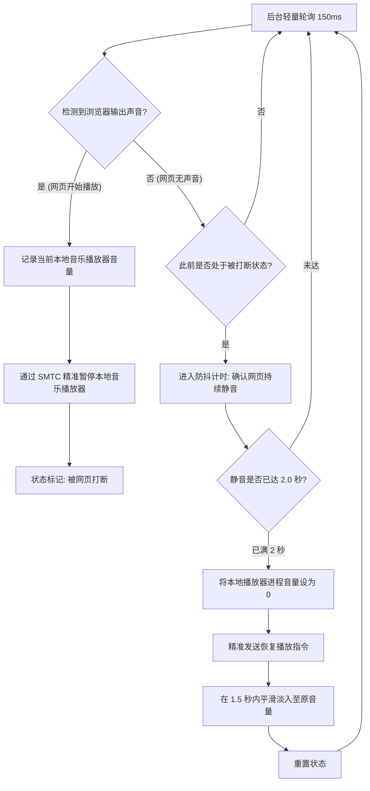

# 🎵 Smart Audio Focus for Windows

<p align="center">
  
  
  
  
</p>

> **让 Windows 拥有媲美移动端的“音频焦点管理（Audio Focus）”体验。**  
> 正在听音乐时点开网页视频？本地播放器自动暂停；视频播放完毕或暂停？等待 2 秒防抖缓冲后，本地音乐自动恢复播放，并伴有**平滑优雅的音量淡入**。

---

## ✨ 核心特性

- ⚡ **极致轻量、超低开销**：
  - 基于 Windows 底层 Core Audio (WASAPI) 的峰值音量监听与会话句柄缓存，单次轮询微秒级完成。
  - 常驻后台 CPU 占用率稳定在 **< 0.1%**，内存占用仅约 **20MB**。
- 🎯 **精准控制，绝不误触**：
  - 深度整合 **Windows 原生系统媒体传输控制（SMTC）** 与 WASAPI 进程音量控制。
  - 只对指定的本地播放器发送暂停/播发指令，**绝不会像盲目发送媒体快捷键那样误将浏览器网页暂停**。
- ⏳ **2 秒防抖等待缓冲**：
  - 网页视频经常存在卡顿、缓冲、分段或短暂静音。脚本具备智能防抖逻辑，只有在网页持续静音满 2 秒后才会恢复音乐，告别频繁“抽搐”。
- 🎶 **平滑优雅的音量淡入 (Fade-In)**：
  - 恢复播放时，先将播放器进程音量置为 0，启动播放后在 1.5 秒内线性平滑恢复至原音量，避免声音突然炸耳。
  - **单进程独立音量控制**：仅淡入音乐播放器自身音量，完全不干扰系统全局音量。
- 🛡️ **开箱即用，支持国内主流全平台**：
  - 预设支持 Chrome、Edge、Firefox、Brave、360、Arc 等几乎所有主流浏览器；
  - 预设支持 foobar2000、网易云音乐、QQ音乐、Spotify、PotPlayer、VLC、AIMP、MusicBee 等各类播放器。

---

## 🔄 工作原理



---

## 🚀 快速上手

### 1. 环境准备
确保已安装 **Python 3.10 或更高版本**（安装时记得勾选 `Add Python to PATH`）。

双击运行目录下的 **`install_requirements.bat`** 即可自动安装依赖：
```bash
pip install -r requirements.txt
```
*(主要依赖项：`pycaw`、`winsdk`、`psutil`、`comtypes`)*

---

### 2. 启动方式

* **方式一：控制台调试运行**
  - 双击 **`start_console.bat`**
  - 会弹出一个控制台窗口，实时输出音频检测与切换日志，按 `Ctrl + C` 可随时退出。

* **方式二：静默后台运行（日常推荐）**
  - 双击 **`start_silent.vbs`**
  - 完全无黑框、无弹窗，在系统后台静默监控。

* **停止运行**：
  - 双击 **`stop.bat`** 即可一键安全终止后台监控进程。

---

## ⚙️ 个性化配置说明 (`config.json`)

根目录下的 `config.json` 支持随时根据个人习惯自定义参数：

```json
{
  "browser_processes": [
    "chrome.exe",
    "msedge.exe",
    "firefox.exe",
    "brave.exe",
    "opera.exe",
    "vivaldi.exe",
    "arc.exe",
    "360chrome.exe"
  ],
  "player_processes": [
    "foobar2000.exe",
    "cloudmusic.exe",
    "qqmusic.exe",
    "spotify.exe",
    "potplayer64.exe",
    "potplayer.exe",
    "vlc.exe",
    "aimp.exe",
    "musicbee.exe",
    "yesplaymusic.exe"
  ],
  "resume_delay_seconds": 2.0,
  "fade_in_duration_seconds": 1.5,
  "fade_in_steps": 15,
  "peak_threshold": 0.003,
  "poll_interval_seconds": 0.15,
  "session_refresh_interval_seconds": 3.0
}
```

### 参数详解

| 配置项 | 默认值 | 作用与说明 |
| :--- | :--- | :--- |
| `browser_processes` | 常见浏览器列表 | 被监控的浏览器进程名（只要列表中任一进程发出声音即触发暂停）。 |
| `player_processes` | 常见播放器列表 | 受控的本地音乐/媒体播放器进程列表。 |
| `resume_delay_seconds` | `2.0` | **网页停止播放后的防抖等待时间（秒）**。只有连续静音满此时间才恢复音乐。 |
| `fade_in_duration_seconds` | `1.5` | **恢复播放时的音量平滑淡入时长（秒）**。若不需要淡入可设为 `0`。 |
| `fade_in_steps` | `15` | 淡入过程中的音量调节阶数，阶数越高淡入越平滑细腻。 |
| `peak_threshold` | `0.003` | 声音判定阈值（`0.0 ~ 1.0`）。避免背景微弱白噪音误触发。 |
| `poll_interval_seconds` | `0.15` | 轮询检查周期（150ms 响应迅速且 CPU 占用忽略不计）。 |

---

## 💡 开机自启设置

如果你希望每次开机自动在后台运行：
1. 按下 `Win + R` 键，输入 `shell:startup` 回车，打开 Windows 系统启动文件夹；
2. 为目录下的 **`start_silent.vbs`** 创建一个桌面快捷方式；
3. 将该快捷方式剪切/粘贴到刚刚打开的 `shell:startup` 文件夹中即可。

---

## 📄 开源许可证

本项目基于 [MIT License](LICENSE) 开源发布，欢迎自由 Star、Fork 或提交 Issue/PR！
